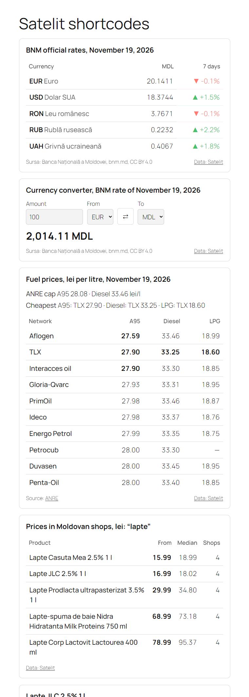
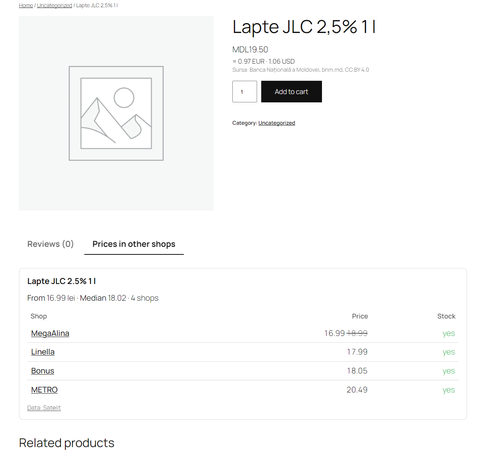
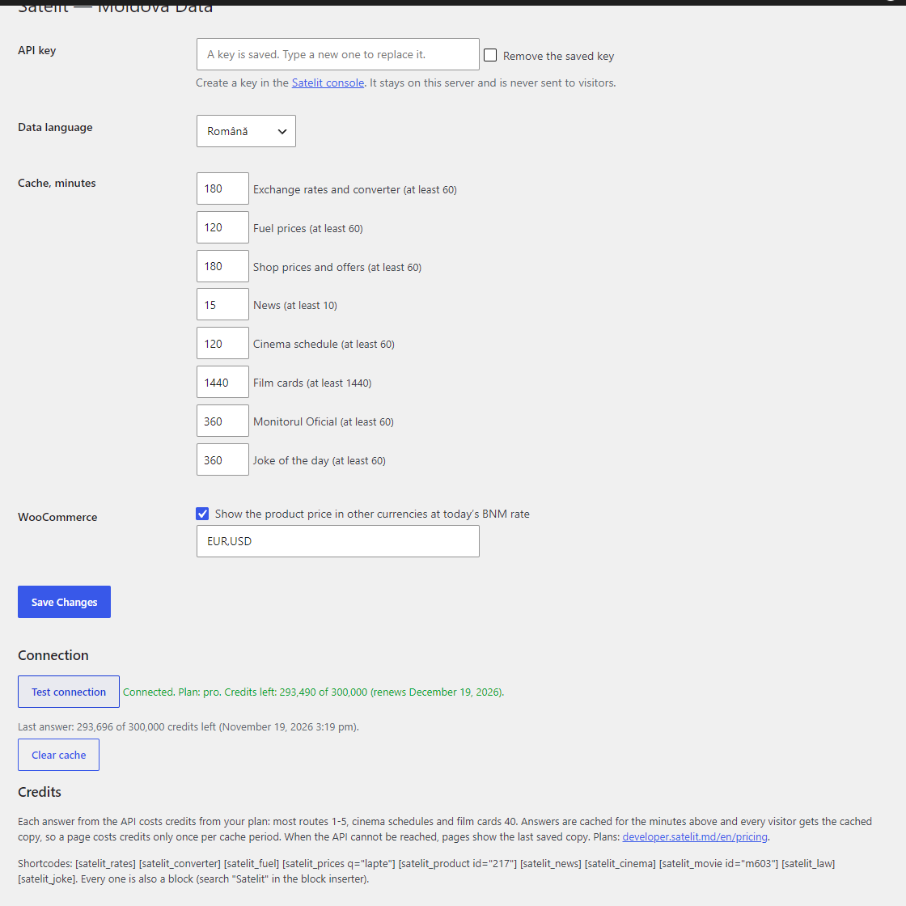

# Satelit — Moldova Data (WordPress plugin)

BNM exchange rates, a MDL converter, fuel prices with the ANRE cap, prices in Moldovan shops, news, cinema schedules, Monitorul Oficial digests and the joke of the day on any WordPress site, from the [Satelit API](https://developer.satelit.md/en/docs/). Every feature is a **shortcode**, a **block** and, where it fits a sidebar, a **classic widget**. With WooCommerce it adds a **"Prices in other shops"** product tab and the price in EUR/USD at today's BNM rate.



Real output of `[satelit_rates]` on 19 Nov 2026 (text of the rendered table):

```
BNM official rates, November 19, 2026
Currency            MDL      7 days
EUR Euro            20.1411  ▼ -0.1%
USD Dolar SUA       18.3744  ▲ +1.5%
RON Leu românesc     3.7671  ▼ -0.1%
RUB Rublă rusească   0.2232  ▲ +2.2%
UAH Grivnă ucraineană 0.4067 ▲ +1.8%
Sursa: Banca Națională a Moldovei, bnm.md, CC BY 4.0        Data: Satelit
```

## Features

| Shortcode | Block | Widget | Shows | API route | Credits |
|---|---|---|---|---|---|
| `[satelit_rates codes="EUR,USD,RON,RUB,UAH"]` | `satelit/rates` | yes | BNM rates, 7-day change arrows, BNM attribution | `/rates` | 1 |
| `[satelit_converter codes="EUR,USD,RON,RUB,UAH,GBP" amount="100"]` | `satelit/converter` | yes | MDL converter; rates embedded server-side, ~1 KB of vanilla JS | `/rates` | 1 (shared cache) |
| `[satelit_fuel limit="10"]` | `satelit/fuel` | yes | Prices per network (cheapest A95 first), ANRE cap, cheapest network per fuel | `/fuel` | 1 |
| `[satelit_prices q="lapte" limit="5"]` | `satelit/prices` | | Products with lowest and median price and number of shops | `/prices/search` | 3 |
| `[satelit_product id="217" limit="10"]` | `satelit/product` | | Every shop's offer for one product (shop name, price, old price, stock) | `/prices/items/{id}` | 2 |
| `[satelit_news limit="5" category=""]` | `satelit/news` | yes | Latest news cards with links to their outlets | `/news` | 2 |
| `[satelit_cinema city="Chișinău" limit="8"]` | `satelit/cinema` | | Today in cinemas: posters, session times per cinema | `/movies/cinemas/today` | 40 |
| `[satelit_movie id="m603"]` | `satelit/movie` | | Film card: poster, year, runtime, genres, rating, overview, director, cast | `/movies/titles/{id}` | 40 |
| `[satelit_law days="7"]` | `satelit/law` | yes | Monitorul Oficial digests (date, number of acts) | `/law/digests` | 2 |
| `[satelit_joke]` | `satelit/joke` | yes | Joke of the day with its source | `/jokes/today` | 1 |

`category` takes a key of `/v1/news/categories` (`politics`, `economy`, `society`, …). `id` of `[satelit_product]` is a Satelit item id (from `/v1/prices/search`); `id` of `[satelit_movie]` is a Satelit title id (`m…` films, `s…` series).

**WooCommerce** (hooks in only when WooCommerce is active):

- A side box "Satelit: prices in other shops" on the product screen takes search words or a Satelit item id. Products that have one get a **"Prices in other shops"** tab.
- Optional (Settings → Satelit): a line under the product price with the price in other currencies at today's BNM rate, e.g. `≈ 0.97 EUR · 1.06 USD` for 19.50 MDL, with the BNM attribution.



## Requirements

- WordPress 5.0 or newer, PHP 7.2 or newer (see "Tested with").
- A Satelit API key. Satelit is a paid API: plans at <https://developer.satelit.md/en/pricing/>, keys in the console at <https://developer.satelit.md/en/console/>. You can look at the data first with the keyless `GET https://api.satelit.md/v1/sample`.
- No Composer, Node or build step at runtime: the zip is the plugin.

## Install

1. Download `satelit-moldova-data.zip` (or build it: `sh bin/build-zip.sh` → `build/satelit-moldova-data.zip`).
2. WordPress admin → Plugins → Add New → Upload Plugin → choose the zip → Install → Activate.
   With WP-CLI: `wp plugin install satelit-moldova-data.zip --activate`.

## Configure

Settings → Satelit:

- **API key** — a password field. The saved key is never shown again (the field stays empty with "A key is saved"); leave it empty to keep it, tick "Remove the saved key" to delete it.
- **Data language** — `ro`, `ru`, `en`, `uk`, or the site language.
- **Cache, minutes** — per product, with floors that protect your credits.
- **WooCommerce** — the price line in other currencies and its codes.
- **Test connection** — calls `GET /v1/me` (0 credits) through admin-ajax and shows the plan and credits left, e.g. `Connected. Plan: pro. Credits left: 297,454 of 300,000 (renews December 19, 2026).`
- **Clear cache** — drops every cached answer.



## Usage

Shortcodes go anywhere shortcodes work. In the block editor search "Satelit" in the inserter: each block has its fields in the sidebar and a live preview (server-side render). For sidebars, add the widget "Satelit — Moldova Data" and pick what it shows.

```
[satelit_rates codes="EUR,USD"]
[satelit_prices q="smantana 20%" limit="8"]
[satelit_cinema city="Bălți"]
```

The output inherits the theme's font and colours (borders are tints of the text colour), so it works on light and dark themes, and it fits a 390 px phone screen. Styles load only on pages that show Satelit data. Override them with the `.satelit` classes.

## Caching and credits

All calls go through one class (`includes/class-satelit-api.php`): `wp_remote_get`, 8 s timeout, WordPress transients. Every visitor gets the cached copy, so a page costs credits once per cache period.

| Product | Default cache | Lowest allowed |
|---|---|---|
| Rates and converter | 3 h | 1 h |
| Fuel | 2 h | 1 h |
| Shop prices, product offers | 3 h | 1 h |
| News | 15 min | 10 min |
| Cinema today | 2 h | 1 h |
| Film cards | 24 h | 24 h |
| Monitorul Oficial | 6 h | 1 h |
| Joke of the day | 6 h | 1 h |

When the API fails:

- a **saved copy** of the last good answer (kept a week) is shown, marked "saved copy";
- after a network failure or a 5xx answer, calls **pause for 2 minutes** (429: for `Retry-After`), so a dead API costs one 8 s wait, not one per block per view;
- a refused key (401/402/403) pauses calls for 5 minutes and shows an **admin notice** on every admin page; saving a new key or "Test connection" ends the pause;
- 404/422 (a wrong id) is remembered for 10 minutes for that shortcode only;
- visitors never see an error: with no data the block prints nothing; administrators see one short line in its place.

With `WP_DEBUG_LOG` on, each failure logs one short line (`Satelit: GET /rates failed: satelit_unreachable`).

`SATELIT_MD_API_BASE` (a constant in `wp-config.php`) or the `satelit_md_api_base` filter change the API base URL.

## Attribution

Shown with the data, as the API asks: `meta.attribution` when the API sends one (BNM rates: "Sursa: Banca Națională a Moldovei, bnm.md, CC BY 4.0"), the source link for fuel (ANRE), Monitorul Oficial and jokes, the shop name with every price offer, the outlets with every news card, and a "Data: Satelit" link to satelit.md in every block.

## Privacy

Requests go from your server to `api.satelit.md` with your key, the route, the shortcode's parameters and the data language. No visitor data is sent. Film posters are loaded by the visitor's browser from `api.satelit.md/v1/movies/img/…`.

## Tested with

Run on 19 Nov 2026 in Docker (official `wordpress` and `mariadb` images), plugin installed with WP-CLI from the release zip, key saved through the settings form, live API.

| WordPress | PHP | Database | Extra | Result |
|---|---|---|---|---|
| 7.1.5 | 8.3.36 | MariaDB 11.8.9 | WooCommerce 11.3.0, Twenty Twenty-Five | all 10 shortcodes, 10 blocks, product tab, price line, settings, test connection |
| 6.9.4 | 8.3.31 | MariaDB 11.8.9 | | all 10 shortcodes; bad key, API down, timeout; ro_RO and ru_RU translations |
| 5.9.3 | 7.4.29 | MariaDB 11.8.9 | | all 10 shortcodes, settings form |
| 5.0.3 | 7.2.15 | MariaDB 11.8.9 | | all 10 shortcodes, 10 blocks, settings form |

Static checks: `php -l` and the offline tests on PHP 7.2.34, 7.4.33 and 8.3.36; PHPCS 3.13.6 with WordPress Coding Standards 3.4.1 (`WordPress` ruleset) and PHPCompatibilityWP 2.1.8 (`testVersion 7.2-`): no errors, no warnings.

## Development

```sh
php tests/run.php                       # offline tests: fake WordPress functions, canned API answers (tests/fixtures), no network
SATELIT_API_KEY=sat_live_… php tests/run.php --live   # opt-in live smoke test (about 3 credits)
composer install && vendor/bin/phpcs    # coding standards (dev only)
sh bin/build-zip.sh                     # build/satelit-moldova-data.zip from the last commit
```

Translations: `languages/satelit-moldova-data.pot` (made with `wp i18n make-pot`), Romanian and Russian `.po`/`.mo`. CI (`.github/workflows/ci.yml`) runs lint and the offline tests on PHP 7.2/7.4/8.3, PHPCS, and builds the zip; it needs no secrets.

## Troubleshooting

- **Nothing shows on the page** — log in as an administrator and look at the page: the block's place shows why (no key, key refused, API unreachable). Settings → Satelit → "Test connection".
- **"Satelit: … (401)" notice** — the key is wrong or revoked; paste a new one from the console.
- **402 `plan_required`** — the key has no active plan: <https://developer.satelit.md/en/pricing/>.
- **Old numbers** — "Clear cache", or lower the cache minutes.
- **Error codes** — <https://developer.satelit.md/en/errors/>.

## Pe scurt (română)

Plugin WordPress pentru datele Satelit: cursurile BNM cu variația pe 7 zile, convertor MDL, prețurile carburanților cu plafonul ANRE, prețuri în magazinele din Moldova, știri, programul cinematografelor, sinteza Monitorului Oficial și bancul zilei — ca shortcode-uri, blocuri și widget. Cu WooCommerce adaugă fila „Prețuri în alte magazine” și prețul produsului în EUR/USD la cursul BNM. Cheia API se pune în Setări → Satelit (rămâne pe server, nu ajunge la vizitatori); răspunsurile stau în cache, iar când API-ul nu răspunde se arată ultima copie salvată. Traduceri în română și rusă incluse. Cheile și planurile: <https://developer.satelit.md/en/pricing/>.

## License

MIT — see [LICENSE](LICENSE). Copyright (c) 2026 Satelit (satelit.md).
